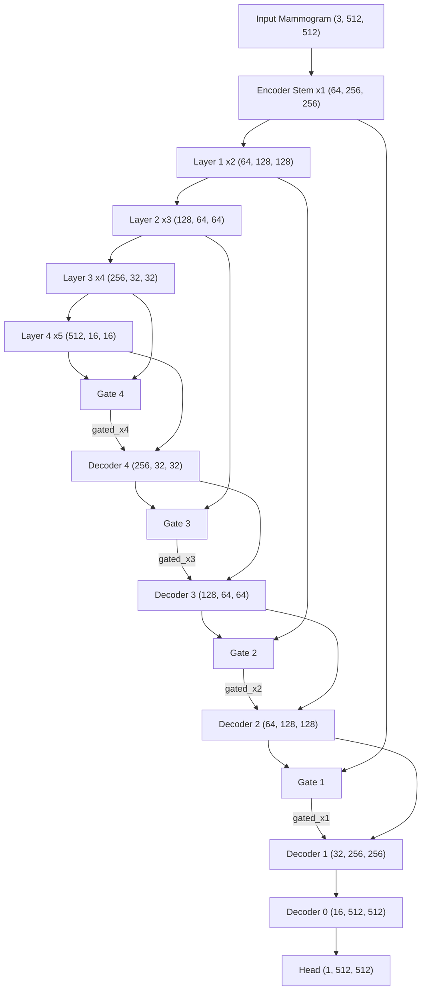

# Architecture & Model Provenance Documentation (MODELS.md)

This document provides complete provenance, wiring specifications, and minimal adaptations for all three segmentation models used in this study: **U-Net**, **Attention U-Net**, and **DeepLabV3**, adhering strictly to Hard Rules 1 & 2.

---

## 1. Model Provenance & Source Repositories

| Model | Upstream Source Repository | Framework / Package | Backbone | Pretrained Weights |
| :--- | :--- | :--- | :--- | :--- |
| **U-Net** | [qubvel-org/segmentation_models.pytorch](https://github.com/qubvel-org/segmentation_models.pytorch) | `segmentation_models_pytorch>=0.3.3` | ResNet34 | ImageNet (`weights="imagenet"`) |
| **DeepLabV3** | [qubvel-org/segmentation_models.pytorch](https://github.com/qubvel-org/segmentation_models.pytorch) | `segmentation_models_pytorch>=0.3.3` | ResNet34 | ImageNet (`weights="imagenet"`) |
| **Attention U-Net** | [ozan-oktay/Attention-Gated-Networks](https://github.com/ozan-oktay/Attention-Gated-Networks) + SMP ResNet34 | Vendored in `third_party/` | ResNet34 | ImageNet (`weights="imagenet"`) |

### Justification for DeepLabV3 Architecture Choice:
We selected `smp.DeepLabV3(encoder_name="resnet34", encoder_weights="imagenet", in_channels=3, classes=1)` over torchvision's `deeplabv3_resnet50`.
- **Fair Architectural Comparison (Rule 3):** Using identical `resnet34` ImageNet-pretrained backbones across all three models isolates the architectural contribution of:
  1. Dense feature concatenation (U-Net)
  2. Gated skip-connection filtering (Attention U-Net)
  3. Multi-scale Atrous Spatial Pyramid Pooling (DeepLabV3)
  without confounding differences in backbone depth, parameter count, or capacity (e.g. ResNet34 vs ResNet50).

---

## 2. Hard Rule 1 Compliance: 100% Unfrozen Weights

Every parameter in every model is fully unfrozen and updated by the optimizer:
1. `param.requires_grad = True` is explicitly verified for all layers, including stem, ResNet stages, batch normalization layers, attention gates, decoder blocks, and segmentation heads.
2. Models run in `.train()` mode during training (BatchNorm statistics and affine parameters update dynamically).
3. The startup verification function (`src/models.py:verify_all_trainable`) asserts:
   $$\text{total\_params} == \text{trainable\_params}$$
   and throws a fatal exception if any parameter is frozen.
4. **Differential Learning Rates:** Parameters are split into two groups in AdamW:
   - **Encoder Parameter Group:** `lr = 1e-4`, `weight_decay = 1e-4`
   - **Decoder / Head / Gate Parameter Group:** `lr = 1e-3`, `weight_decay = 1e-4`

---

## 3. Attention U-Net: Attention Gate Wiring & Equations

### Mathematical Formulation (Oktay et al., 2018)
The Grid Attention Gate takes two input signals:
1. $x^l \in \mathbb{R}^{C_l \times H_l \times W_l}$: The skip-connection feature map from level $l$ of the ResNet34 encoder.
2. $g \in \mathbb{R}^{C_g \times H_g \times W_g}$: The gating signal from the coarser, deeper decoder level ($H_g = H_l / 2, W_g = W_l / 2$).

The attention mechanism computes scalar attention coefficients $\alpha^l \in [0, 1]$:
$$\theta_x = W_\theta * x^l \quad (\text{stride } 2 \text{ subsampling to match intermediate grid})$$
$$\phi_g = \text{Interp}(W_\phi * g) \quad (1\times 1 \text{ conv, interpolated to } \theta_x \text{ resolution})$$
$$f = \text{ReLU}(\theta_x + \phi_g) \quad (\text{additive fusion})$$
$$\psi_f = W_\psi * f \quad (1\times 1 \text{ conv reducing to } 1 \text{ channel})$$
$$\alpha^l = \text{Interp}(\sigma(\psi_f)) \quad (\text{Sigmoid activation, upsampled to } (H_l, W_l))$$
$$\hat{x}^l = \alpha^l \odot x^l \quad (\text{element-wise attention weighting})$$
$$y^l = W * \hat{x}^l \quad (1\times 1 \text{ conv } + \text{ BatchNorm})$$

### ResNet34 Encoder to Attention Gate Wiring Table

| Stage | Encoder Feature $x^l$ | Spatial Res | Gating Signal $g$ | Gate Channels $(C_{in}, C_g, C_{int})$ | Attended Output | Decoder Block | Decoder Output |
| :--- | :--- | :--- | :--- | :--- | :--- | :--- | :--- |
| **Bottleneck** | `x5` (Layer 4) | $16 \times 16$ | — | — | — | — | $d_5 = x5$ (512 ch) |
| **Stage 4** | `x4` (Layer 3) | $32 \times 32$ | $x5$ ($16 \times 16$) | `(256, 512, 128)` | `gated_x4` (256 ch) | `dec4(x5, gated_x4)` | $d_4$ (256 ch, $32 \times 32$) |
| **Stage 3** | `x3` (Layer 2) | $64 \times 64$ | $d_4$ ($32 \times 32$) | `(128, 256, 64)` | `gated_x3` (128 ch) | `dec3(d4, gated_x3)` | $d_3$ (128 ch, $64 \times 64$) |
| **Stage 2** | `x2` (Layer 1) | $128 \times 128$ | $d_3$ ($64 \times 64$) | `(64, 128, 32)` | `gated_x2` (64 ch) | `dec2(d3, gated_x2)` | $d_2$ (64 ch, $128 \times 128$) |
| **Stage 1** | `x1` (Stem) | $256 \times 256$ | $d_2$ ($128 \times 128$) | `(64, 64, 32)` | `gated_x1` (64 ch) | `dec1(d2, gated_x1)` | $d_1$ (32 ch, $256 \times 256$) |
| **Stage 0** | — | $512 \times 512$ | $d_1$ ($256 \times 256$) | — | — | `dec0(d1)` | $d_0$ (16 ch, $512 \times 512$) |
| **Head** | — | $512 \times 512$ | $d_0$ | — | — | `Conv2d(16, 1, 1)` | Logits (1 ch, $512 \times 512$) |



---

## 4. Minimal Code Adaptations Documented

1. **`third_party/Attention-Gated-Networks/models/layers/grid_attention_layer.py` (Lines 11–110):**
   - **Origin:** Official Oktay et al. repository (`models/layers/grid_attention_layer.py`).
   - **Adaptation:** Encapsulated into standard PyTorch module `GridAttentionBlock2D` with bilinear interpolation and an optional `return_attention=True` flag to allow extracting $\alpha$ heatmaps for visualization.
2. **`src/models.py` (Lines 47–148):**
   - **Origin:** SMP ResNet34 feature hierarchy + U-Net decoder.
   - **Adaptation:** Replaced standard skip concatenation with Oktay attention gate gating:
     ```python
     gated_x4 = self.gate4(x4, x5)
     d4 = self.dec4(x5, gated_x4)
     ```
3. **`src/models.py` (Lines 17–38):**
   - **Adaptation:** Hard Rule 1 strict validation function checking:
     ```python
     total_params = sum(p.numel() for p in model.parameters())
     trainable_params = sum(p.numel() for p in model.parameters() if p.requires_grad)
     assert total_params == trainable_params
     ```

